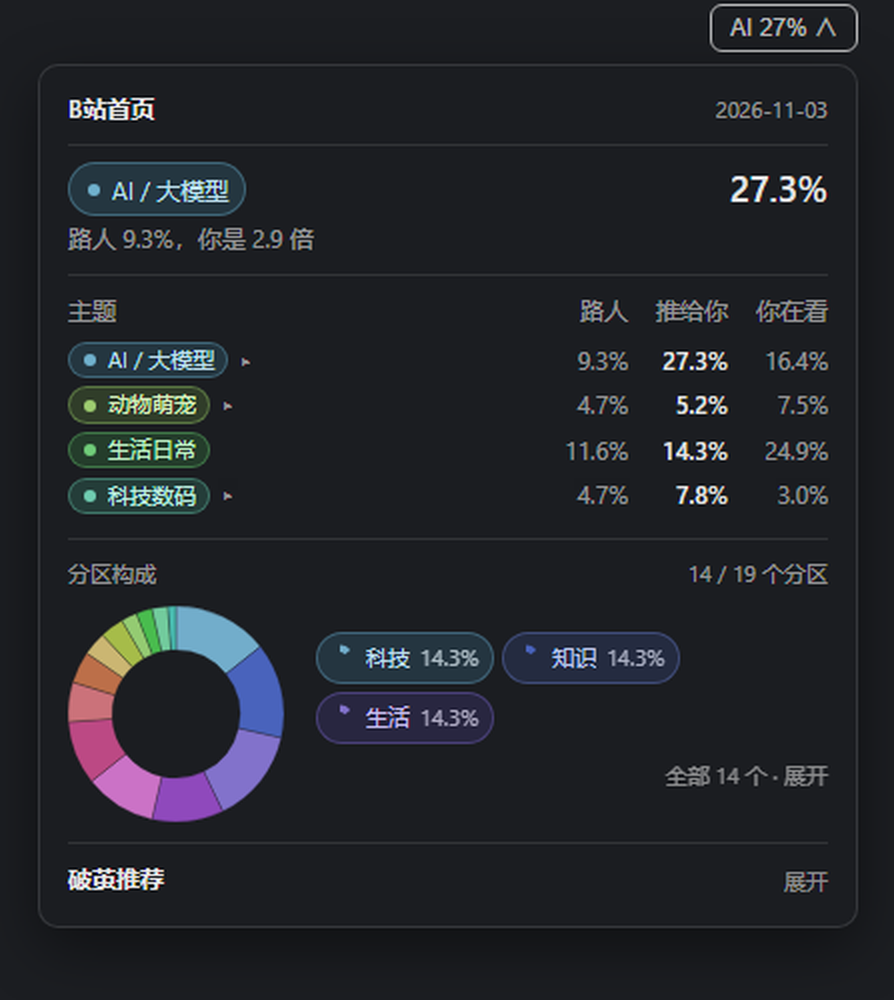
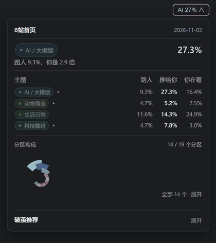
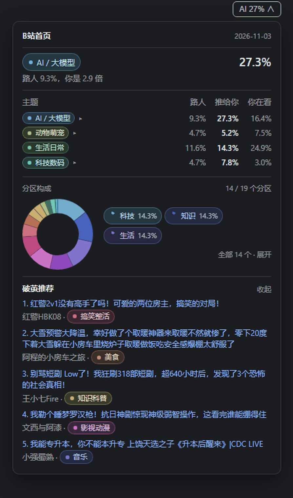

# bili-cocoon

English | [中文](README.zh-CN.md)

**Is Bilibili's recommendation feed narrowing what you see?** On 2026-11-03, this account's logged-in home feed was **27.3 % AI / 大模型** videos; the guest baseline from the same day was **9.3 %** — **2.9×**. This toolkit measures that gap and keeps exposure (what the algorithm pushes) apart from consumption (what the account watches). *Single-account sample — a measured example, not a general claim.*



## Quick start

```bash
node src/cli.js report --demo --out demo-report.md   # no cookie, no network: renders test/fixtures
node src/cli.js collect --limit 12                   # snapshot your own feed; guest mode needs no cookie
node src/cli.js score                                # 0-100 partition/uploader concentration, with its basis
node src/cli.js report --out report.md
```

`--demo` renders the repo fixtures from an in-memory snapshot: no cookie, no network, and it never opens `data/cocoon.db`. The report's first line marks it as demo data.

Login state (required for *your* personalized feed):

```bash
# via environment variable
$env:BILI_COOKIE = "SESSDATA=...; bili_jct=...; DedeUserID=..."

# or via a file
node src/cli.js collect --cookie-file .\cookie.txt
```

Cookies are read **only** from `BILI_COOKIE` or `--cookie-file`; nothing is hardcoded.
`.gitignore` already excludes `cookie*.txt`, `bilibili-vault.json`, `bilibili-key.json`, `data/`, and `*.db`.

> Standalone package (MIT). Ships with a DSH panel plugin under [`plugin/`](plugin/).

---

## Why two sides

A zero-dependency Node.js toolkit that measures two different things — and insists on keeping them apart:

| | What it is | Where it comes from |
|---|---|---|
| **Exposure** | What the algorithm puts in front of you | Home feed (`rcmd`) |
| **Consumption** | What you actually watch | Watch history |

Conflating the two is the most common mistake in filter-bubble tooling. A healthy viewing history says nothing about whether the feed is narrowing. This project reports both sides, plus the gap between them.

A single "bubble score" computed from watch history answers *"is my viewing diverse?"* — not *"is the feed feeding me the same thing?"*

Measured on 2026-11-02, same account, same hour, three sampling rounds. The logged-in feed and the guest baseline are close in size (84 and 82 rows), so the gap below is not a sample-size artefact — it is a **denominator** question:

| AI / LLM share | Logged-in feed | Guest baseline | Ratio |
|---|---:|---:|---:|
| of classified **rows** | 24.4 % | 9.4 % | 2.60× |
| of **distinct videos** (primary) | 24.4 % | 13.3 % | **1.83×** |

The dedup row is the one to quote. The guest feed is resampled from a much smaller pool — 82 rows covering only 38 videos (`repeatRate: 0.54`) against 84 rows covering 84 videos on the logged-in side (`repeatRate: 0`) — so counting rows dilutes whatever the guest baseline is *not* showing and inflates every ratio built on it. The row measure is kept because earlier versions of this README published it; it is the upper bound of the effect, not the effect.

Repetition is not the mechanism either: all 20 AI items in the logged-in feed came from **20 different videos by 20 different uploaders** (`repeatRate: 0`, see [`attribution`](#attribution)). The feed is not re-serving a handful of clips — it tilts the whole topic mix. Counting duplicates would have found nothing here, which is why the tool compares distributions instead of counting repeats.

Watch history is the third sample, and it is the one the index number comes from: 21.1 on the same formula, against 14.9 for the 84-row feed ([why the basis matters](#how-the-concentration-index-is-computed)). A consumption-only index would have called this account "open" and missed the skew above — which is why the two sides stay apart.

## How the concentration index is computed

The 0–100 number shipped by `score`, the panel and `trend` is **partition/uploader concentration** — not a filter-bubble index. It follows Fu et al. (2024), who studied Bilibili, and it is a function of exactly two things: how spread a sample is across the 19 top-level partitions (the payload calls them `categories`), and how spread it is across uploaders.

```
index = 100 × ( 0.55 × (1 − normalized entropy)
              + 0.25 × HHI(categories)
              + 0.20 × Gini(uploader exposure) )
```

**There is no topic term in that formula.** `themes` is a diagnostic block that sits next to the index and never enters it (see [Theme concentration](#theme-concentration-diagnostic)). So the index cannot answer *"is my content all AI / NBA / one game?"* — a dozen partitions and a dozen uploaders serving nothing but the same subject still score as "open". The theme block and the amplification table answer that question; this number does not.

- **Normalized entropy** = `H / ln(19)` — the denominator is fixed at the 19 top-level partitions, so "3 partitions evenly split" (0.373) and "19 partitions evenly split" (1.0) remain distinguishable.
- **Effective categories** = `exp(H)` (Hill number, q=1) — reads as "how many partitions you effectively watch".
- **HHI** = `Σp²`; 1.0 means everything sits in one partition.
- **Gini** measures whether exposure concentrates on a few uploaders.
- Entropy ships with a **bootstrap 95 % interval** (seed derived from the date, so the same input always yields the same output).

Diagnostics only — deliberately kept out of the score:

- Jaccard overlap with the site-wide ranking (structurally near zero at small sample sizes; an earlier version wrongly weighted it at 20 %).
- Jensen–Shannon divergence between feed and history distributions.
- Theme concentration ([below](#theme-concentration-diagnostic)) — the one most likely to be mistaken for the index, which is exactly why it is labelled diagnostic.

### `basis`: the same formula, three different numbers

`cocoonScore()` picks its sample in one line — `basis = history.length >= 10 ? 'history' : 'feed'` — and the same arithmetic scores those samples several points apart. All three of these exist at once in this repository on 2026-11-02:

| sample | rows | index | basis |
|---|---:|---:|---|
| Logged-in feed, 3 sampled rounds (`feed`) | 84 | 14.9 | `feed` |
| Daily `rcmd` snapshot (`rcmd`) | 28 | 18.4 | `feed` |
| Watch history (`history`) | 210 | 21.1 | `history` |

**21.1 is the watch-history number, not the home feed's.** The arithmetic is right; calling it "the feed's cocoon score" is what is wrong. Nothing in the formula differs between the three rows — only the sample does. Every consumer has to label it: `cocoonScore()` returns `basis`, and the summary endpoint exposes it per day as [`trend.points[].basis`](#trend). The `trend` points for 2026-10-30 through 2026-11-03 are all `history` with 209/209/210/210 rows, which is why they sit between 21 and 23 instead of near 15.

### Calibration: the labels carry very little information

`level` cuts the 0–100 range at 25/50/70, and the scale is dull in the direction that matters: a **single theme has to reach 57.3 %** of a sample before the index crosses 25 and reads "leaning narrow", and **81.1 %** before it reaches 50. In other words the "open" bucket covers every sample with a single-theme share from 0 % to 57 %, which is where almost everything lands. Read it as a coarse bucket, not a verdict; the components (`entropyNorm`, `hhi`, `gini`, `themes.concentration`) and the sample size are what carry information.

Levels, with that caveat attached: `<25 open / <50 leaning narrow / <70 clearly narrowing / ≥70 strong bubble`.

### Why top-level categories

The history endpoint only returns second-level category names ("单机游戏", "美食记录") — and there are 150+ of them. Computing entropy at that granularity counts "two different games" as unrelated content and **massively overstates diversity**. An early version scored 0.98 entropy on 28 items this way and declared the user "open".

Two lookup tables work together:

- `src/region-map.json` — second-level name → top-level category (110 entries), derived from the ranking endpoint plus manual patches.
- `src/tid-region.json` — `tid` → second-level name (64 entries), generated by `tools/build-tid-map.mjs`.

**Why the second table is required:** `/x/web-interface/view` no longer returns `tname` — only `tid`. Without the mapping, feed items degrade to placeholder names like `分区230`, the category resolver cannot fold them into a top-level bucket, and both the feed distribution and the JSD diagnostic are silently wrong. This actually happened for three days of collected data and was repaired with `tools/fix-region-labels.mjs`.

### Theme concentration (diagnostic)

Category entropy answers "how many categories did you watch?" — not "is this all the same topic?". Someone can browse a dozen categories and still consume nothing but AI content.

```
top theme share  = largest theme share among classified items
effective themes = exp(theme entropy)      ← compare against effective categories
```

Classification lives in `src/themes.js` and uses three signals, in this order:

1. **Title keywords** (AI / games / tech / science / daily life / food / animals / comedy / film & anime / music) — ten themes, plus `未分类`.
2. **Second-level category fallback** — titles are often pure slang ("挤爆了", "草莓咪") with no topical signal. Keyword-only coverage is around 31 %; the category fallback carries most of the rest.
3. **Tag evidence** — stored `video_tag` rows, consulted only where title and category both miss.

Unclassified items are excluded from the denominator, and coverage is reported per sample: 97.6 % on the 2026-11-02 logged-in feed, 78.1 % on the guest baseline, 98.6 % on watch history. Coverage is a property of the content, not of the classifier — compare shares only between samples whose coverage is comparable. This is keyword matching, not NLP — below 80 % coverage, read the trend, not the absolute number.

### References

- Fu, Che, Li, Yuan & Min (2024). *Heavy users fail to fall into filter bubbles: evidence from a Chinese online video platform.* Frontiers in Physics 12:1423851.
- Hill numbers / effective number of species: <https://en.wikipedia.org/wiki/Diversity_index>
- Jensen–Shannon divergence for distribution comparison (calibration diagnostic).
- Kitchens, Johnson & Gray — four dimensions of source diversity (count / spread / balance / type). Only the dimensions this data can support are implemented.

## Data caveats (read before trusting numbers)

- **Home-feed cards carry no category field** (no `tid` / `tname` / `tags` in the payload). `collect` therefore enriches each item through `/x/web-interface/view` at 1 req/s. `--no-enrich` skips this, but then category entropy is meaningless (`score` warns about it).
- **`view` returns an empty `tname`** — in guest mode *and* (as of Nov 2026) in logged-in mode. Only `tid` is populated. Category names come from `src/tid-region.json`, resolved via `x/web-interface/ranking/region?rid=<tid>&day=3`.
- **Names are not cosmetic.** `parentOf()` folds items into top-level categories by name; a missing name drops the item into "other" and distorts both the feed distribution and JSD. `collect` prints a warning for unregistered `tid`s; `build-tid-map` fills them in.
- **Guest feeds are generic** (`personalized=false`) and reflect what Bilibili shows a stranger — not your personal feed.
- **Watch history requires login**; guest mode skips it (non-fatal).

## Exposure side vs consumption side

| Side | Source | Answers | Command |
|---|---|---|---|
| **Consumption** | `history` | What did I actually watch? | `collect` / `score` / `report` |
| **Exposure** | `rcmd` | What does the algorithm push at me? | `exposure` |

`score` measures **consumption only**. A healthy consumption profile does not imply a narrow feed.

### How the baseline is built

A guest identity with a **fresh `buvid3` on every round** (`resetBuvid()`) — effectively "a brand-new device that has never visited". What cannot be changed: IP, city, ISP, user agent. So it is "no account history", not a truly neutral baseline.

### Known boundaries (measured Nov 2026)

- Only the **web** feed (`x/web-interface/wbi/index/top/feed/rcmd`) is sampled.
- The App endpoint `app.bilibili.com/x/v2/feed/index` is reachable without a signature but **ignores `SESSDATA`**: AI share stayed at 5.0 % with and without the login cookie, which suggests it authenticates via `access_key`. What we can fetch there is the *App guest* feed, not what a phone user sees.
- Watch history is **account-level** and shared between App and web, so the consumption side does describe behavior on both clients.

## Commands

```
collect  [--db path] [--limit n] [--cookie-file path] [--login] [--no-enrich]
score    [--db path] [--days n] [--json]
report   [--db path] [--days n] [--out path]
exposure [--db path] [--rounds n] [--per-round n] [--no-enrich]
```

Maintenance tools (run manually, not part of the daily flow):

```
node tools/build-tid-map.mjs          # resolve tid → category name, extend src/tid-region.json
node tools/build-tid-map.mjs --tid 17,173
node tools/fix-region-labels.mjs      # backfill historical "分区NNN" placeholders (--dry-run first)
node tools/collect-login.mjs 30 7     # collect using the DSH bilibili plugin's vault cookie
node tools/exposure-login.mjs 3 28    # exposure sampling: logged-in feed vs guest baseline
node tools/trend.mjs                  # multi-day trend: index / entropy / uploader spread / overlap
```

## DSH panel plugin

`plugin/` is a DeepSeek Harness client plugin. It injects a pill into the conversation header (`conversation.session.header.actions`, `order: 13`) right next to the bilibili plugin's own pill. The pill reads `AI 27%` — the leading theme and its share of the home feed — because a share stands on its own while a ratio only means something once its baseline is explained. Expanding it gives that number, a three-column comparison, a partition pie, and what the guest feed carries that the home feed never does:

```
theme                newcomer   fed to you   you watch
AI / LLM                13.3%  →   24.4%    ←  historyShare
```

Both percentages are shares of **distinct videos**, the primary measure; a summary from before the dedup fields falls back to row shares. The row measure is still served, and on 2026-11-02 reads 9.4 % → 24.4 % (2.60×) — the pair earlier versions of this README printed. `you watch` is the theme's share of the history sample: a third distribution, not a third copy of the same ratio, so it is not restated here.

The pie replaced a 0–100 composite score that had been on the panel. The score was a weighted mix of partition entropy, HHI and uploader Gini — correct as a metric, unreadable as a panel element: reading it required the formula, and the scale is so dull that almost every sample lands in the same bucket. The pie needs no formula. It shows what share each top-level partition holds, and `14 / 19 个分区` answers the other question the score was standing in for: how much of the site this feed reaches at all. On 2026-11-03 that is 14 partitions with no single one above 14.3 % — the shape says "spread out" faster than any number did.





The host half only reads `cocoon.db` and serves `GET /dsh-bilibili-cocoon/summary`; it never writes, never polls, and returns `{ ok: false, error }` instead of throwing — a failing plugin takes the whole GUI down with it.

It is a **separate package on purpose**: `@seiuna/dsh-bilibili-plugin` is shipped as a prebuilt bundle, so adding features there would mean maintaining a fork. Slots are global and ordered, so an independent plugin lands visually next to it without touching upstream code.

## What the summary endpoint returns

`GET /dsh-bilibili-cocoon/summary` answers `200` even when it fails — the only exception is `405` for a non-`GET` and `404` for any other path under the prefix. The body is exactly what `buildSummary()` in [`plugin/lib/index.js`](plugin/lib/index.js) returns:

| key | type | meaning |
|---|---|---|
| `ok` | boolean | `true` on success. A failure shrinks the body to `{ ok: false, error, dbPath }` and keeps the 200 |
| `date` | string | the exposure day being described (`YYYY-MM-DD`) — the newest day in `exposure`, not today |
| `dbPath` | string | the database that was read (read-only) |
| `rounds` | number | how many distinct sampling rounds the rows of `date` came from |
| `login`, `guest`, `history` | object | `{ count, coverage, top }` — `count` rows, `coverage` the classified fraction, `top` up to 5 `{ id, name, n, share }` |
| `amplification` | array | up to 6 `{ id, name, loginShare, guestShare, loginShareDedup, guestShareDedup, historyShare, ratio, ratioDedup }`, sorted by `loginShare − guestShare` descending |
| `headline` | object \| null | `{ id, name, ratio, ratioDedup }` — the first theme in that order with `ratio > 1.2` |
| `feedFocus` | object \| null | what the home feed is made of — `{ top, top3Share, effectiveThemes, totalThemes, units, repeatRate }`, [below](#feedfocus) |
| `categories` | object \| null | the home feed's partition mix — `{ covered, total, units, items }`, [below](#categories) |
| `attribution` | array | up to 3 themes drilled down to uploaders and videos — [below](#attribution) |
| `trend` | object | the last 7 days — [below](#trend) |
| `breakout` | object | what the guest feed carried that the home feed did not — [below](#breakout) |
| `attributionError`, `feedFocusError`, `categoriesError`, `trendError` | string | present only when that block failed; the rest of the body is still valid |

`share` and `coverage` are fractions of **classified** items, not of all rows — items the classifier cannot place are excluded from the denominator (see [Theme concentration](#theme-concentration-diagnostic)). Shares carry 4 decimals, `ratio` 2.

Every theme row carries two ratios over two denominators. `loginShare` / `guestShare` count **rows** over the classified row totals, and `ratio = loginShare / guestShare`. `loginShareDedup` / `guestShareDedup` are the same two shares over the **deduplicated** classified counts, and `ratioDedup = loginShareDedup / guestShareDedup`. Quote the dedup one: the guest feed is resampled from a much smaller pool (82 rows = 38 videos on 2026-11-02), so the row measure inflates every ratio built on it. `ratio` and `ratioDedup` are both `null` when the guest side has no item for that theme. `historyShare` always comes from the row measure — it is the account's own history, not a resampled feed.

`headline` follows the amplification order, not the ratio. On 2026-11-02 that puts AI / 大模型 on top: 24.4 % of the classified logged-in feed against 9.4 % of the guest baseline on rows (`ratio` 2.60), and 24.4 % against 13.3 % on distinct videos (`ratioDedup` 1.83). The two orderings can disagree — a theme can have the larger ratio while another has the larger gap — and this field deliberately follows the gap.

### `categories`

The home feed's partition mix — one entry per top-level partition present in the logged-in feed that day, sorted by count descending. This is what the panel draws as a pie; a missing `categoryCounts` yields `null` rather than an empty ring.

| field | meaning |
|---|---|
| `covered` | how many of the top-level partitions the home feed touches |
| `total` | size of the partition vocabulary (19) |
| `units` | rows behind the mix — the denominator every `share` divides into |
| `items` | `{ name, n, share }` per partition, sorted by `n` descending, untruncated; the panel draws seven wedges — the top six and the rest combined |

Partition names come from `parentOf(tname)`, and a row whose `tid` is missing from `src/tid-region.json` lands in `其他`, so `其他` in this list marks a mapping gap rather than a partition. On 2026-11-03 the 84-row login feed covered 14 partitions with no share above 14.3 % — that flatness is the shape the panel is trying to make legible.

### `feedFocus`

`null` when the day has no classified logged-in feed rows; otherwise the home-feed composition in one block. `top.share` and `top.baselineShare` are on the dedup measure — one denominator, distinct videos — which is why they divide into `ratioDedup` and not into the row ratio. `baselineShareRows` is the same baseline on the row measure: kept for comparison only, never shown in the UI, and not a valid denominator for the dedup `share`.

| field | meaning | 2026-11-02 |
|---|---|---|
| `top` | `{ id, name, share, baselineShare, baselineShareRows, ratio, ratioDedup }` — the largest theme in the logged-in feed | AI / 大模型: `share` 24.4 %, `baselineShare` 13.3 %, `baselineShareRows` 9.4 %, `ratio` 2.60, `ratioDedup` 1.83 |
| `top3Share` | summed `loginShare` of the three largest themes (row measure) | 51.2 % |
| `effectiveThemes` | `exp(theme entropy)` over **distinct videos** — how many themes the feed effectively contains | 8.15 |
| `totalThemes` | size of the theme vocabulary the classifier can emit | 10 |
| `units` | `{ login, guest }` — distinct videos behind each side, i.e. the dedup denominators | 84 / 38 |
| `repeatRate` | `{ login, guest }` — `(rows − distinct videos) / rows` | 0 / 0.54 |

`units` is the whole reason two ratios exist: 84 logged-in rows are 84 distinct videos, while 82 guest rows are 38 distinct videos across 3 rounds, so the row measure counts the same guest video up to three times. `effectiveThemes` is computed over the dedup counts on purpose — counting one video once per re-sample would move it without the feed having changed — and only reads against `totalThemes`: 8.15 of 10 says the feed does reach most of the vocabulary, even while `top3Share` says half of it sits in three themes.

### `attribution`

Up to 3 entries, ordered by `loginShare − guestShare` descending — the same order as `amplification`, so `attribution[0]` is the theme with the largest over-representation, not the largest ratio. Only themes with `ratio > 1.2` qualify.

| field | meaning |
|---|---|
| `id`, `name` | theme id and display name |
| `ratio`, `loginShare`, `guestShare` | copied from the matching `amplification` row — the **row** measure; `ratioDedup` lives only on that row |
| `appearances` | logged-in feed **rows** for the theme across all rounds — the same `bvid` in 3 rounds counts 3 times |
| `uniqueBvids` | distinct videos |
| `repeatRate` | `(appearances − uniqueBvids) / appearances`: the fraction of rows that are not a first sighting. `0` means every row was a different video |
| `topUps` | up to 3 `{ mid, name, n, share }`; `n` is row count, `share` is `n / appearances` |
| `topVideos` | up to 3 `{ bvid, title, upName, mid, rounds, url }`; `rounds` is how many **distinct** rounds that video showed up in (the sort key — "served again and again" first) |

```json
{
  "id": "ai",
  "name": "AI / 大模型",
  "ratio": 2.6,
  "loginShare": 0.2439,
  "guestShare": 0.0938,
  "appearances": 20,
  "uniqueBvids": 20,
  "repeatRate": 0,
  "topUps": [{ "mid": 74513608, "name": "哈哈哈哈哈估计", "n": 1, "share": 0.05 }],
  "topVideos": [{
    "bvid": "BV19q8z6LEnu",
    "title": "DFlash 2：给Qwen3.8-27B配个抢答小模型…",
    "upName": "哈哈哈哈哈估计",
    "mid": 74513608,
    "rounds": 1,
    "url": "https://www.bilibili.com/video/BV19q8z6LEnu"
  }]
}
```

### `trend`

```json
{
  "days": 7,
  "covered": 4,
  "points": [
    { "date": "2026-10-30", "cocoon": 23.1, "amplification": null, "themes": null, "samples": 209, "basis": "history" },
    { "date": "2026-11-01", "cocoon": 22.7, "amplification": null, "themes": null, "samples": 209, "basis": "history" },
    { "date": "2026-11-02", "cocoon": 21.1, "amplification": 2.6, "themes": 10, "samples": 210, "basis": "history" },
    { "date": "2026-11-03", "cocoon": 21.5, "amplification": 2.18, "themes": 10, "samples": 210, "basis": "history" }
  ]
}
```

- `days` is the window width (7), `covered` is how many of those days actually have data.
- `points` is sorted by date ascending and holds **only days that have data** — a missing day is not back-filled with zeros. Read `covered`, not `points.length`, as "how much of the week I have".
- Per point: `cocoon` is the 0–100 **partition/uploader concentration** of the sample named by `basis`, **lower is more spread out**; `basis` is `'history'` once the day has ≥ 10 history rows and `'feed'` otherwise, and is `null` whenever `cocoon` is; `amplification` is that day's `headline.ratio` (row measure); `themes` is the number of distinct themes in the logged-in feed; `samples` is the item count behind `cocoon`.
- Never read `cocoon` without `basis`. The four points above are all `history` over 209/209/210/210 rows, so 23.1 / 22.7 / 21.1 / 21.5 describe **watch history**; the 84-row feed scores 14.9 on the same formula, and a 28-row `rcmd` snapshot 18.4. A `feed`-based point and a `history`-based point are not comparable.
- Each metric degrades on its own: a day with snapshot data but no `exposure` rows still gets a point, with `amplification: null` and `themes: null`. `null` means "not computable", never zero.
- The window ends at the newest day in `snapshot` **or** `exposure`, which can be newer than `date`.

### `breakout`

What the guest baseline carried that the home feed did not. The two sides share almost nothing — 1 video out of 38 on 2026-11-02 — so nearly every guest video is something the account never saw.

| field | meaning |
|---|---|
| `candidates` | guest videos absent from the logged-in feed, counted before the filters below |
| `items[].bvid` / `.title` / `.upName` / `.url` | the video itself; `url` opens it on Bilibili |
| `items[].theme` / `.themeName` | its theme |
| `items[].loginShare` / `.guestShare` | that theme's share on each side, dedup measure |
| `items[].gap` | `guestShare − loginShare`; diagnostic only, never the sort key |
| `items[].upSeen` | whether that uploader appeared in the home feed |

A theme qualifies only when `gap > 0`: the guest side has to carry more of it than the account does, or there is nothing suppressed to surface. Entries are then ordered by `loginShare` **ascending**, rarest first. Ordering by `gap` instead ranks whatever the guest feed happens to over-serve, which can still be a theme the account already sees 14.6 % of the time.

At most five rows, one per theme and one per uploader, and often fewer: on a given day only four or five themes out of ten have a positive gap, and nothing is padded to fill the list. This block describes what a newcomer sees and the account does not — it is not a claim about what the account would enjoy.

## Limitations

Read these before quoting any number above.

- **Ten fixed themes, not a taxonomy.** The classifier emits ten themes plus `未分类`. Content it has no words for — NBA, cars, 宅舞, KPOP, 赶海, crafts, tokusatsu — lands in `未分类` and is excluded from every share denominator. That is why the same classifier reports 78.1 % coverage on the guest baseline and 97.6 % on the logged-in feed: the content differs. Shares are only comparable between samples with comparable coverage.
- **Partition mapping has holes.** On the 2026-11-02 logged-in feed, 19 % of rows had no top-level partition, because `view` now returns an empty `tname`. `parentOf('')` sends those rows to the catch-all `其他` bucket, which both dilutes the real partitions and inflates `其他`; `quality.feedMappedRatio` reports the fraction rather than hiding it (`quality.mappedRatio` is the same check for the sample the index scores). Partition entropy — and therefore the index — is only as good as that mapping.
- **The guest baseline is "no account history", not a neutral baseline.** A fresh `buvid3` per round is the only part that can be reset; IP, city, ISP and user agent cannot. Bilibili's guest feed is still geolocated.
- **Exposure is web-only.** Only `x/web-interface/wbi/index/top/feed/rcmd` is sampled. The App feed (`app.bilibili.com/x/v2/feed/index`) is a different endpoint with different rules, and it ignores `SESSDATA` — see [Known boundaries](#known-boundaries-measured-nov-2026).
- **Four days is not a trend.** 2026-10-30, 11-01, 11-02 and 11-03 are all the data there is; the line moves between 21.1 and 23.1 on samples of ~210 rows. It shows the pipeline works, not that anything is changing.

## What you can read now

One unedited summary from 2026-11-02, three sampling rounds:

| Sample | items | theme coverage | top theme |
|---|---:|---:|---|
| Logged-in feed | 84 | 97.6 % | AI / LLM 24.4 % |
| Guest baseline | 82 | 78.1 % | Film & anime 17.2 % |
| Watch history | 210 | 98.6 % | Daily life 22.7 % |

The logged-in feed's largest theme is AI / LLM at **24.4 %** of classified rows. The guest baseline shows the same theme at **9.4 %** of rows and **13.3 %** of distinct videos — its own largest theme is a different one (film & anime, 17.2 % of classified items), and the history sample is topped by daily life at 22.7 %. That is the skew in one line: the topic the feed pushes hardest at this account is only a mid-sized topic to a stranger. The logged-in feed has no repeats at all (84 rows, 84 videos); the guest feed was resampled from 38 videos across 3 rounds (`repeatRate: 0.54`), which is the entire reason the dedup ratio exists.

Drilling into that 1.83× (2.60× on rows):

- `appearances` 20, `uniqueBvids` 20, `repeatRate` 0 — the 20 AI rows were 20 different videos from 20 different uploaders. The strongest one holds 1 of those 20 rows, nowhere near a third of them: topic-level amplification, not one channel.
- `feedFocus` for the same day: `top3Share` 51.2 %, `effectiveThemes` 8.15 of `totalThemes` 10, `units` 84 / 38, `repeatRate` 0 / 0.54. Half the feed sits in three themes, out of a vocabulary of ten.
- The week: `2026-10-30 → 23.1`, `2026-11-01 → 22.7`, `2026-11-02 → 21.1`, `2026-11-03 → 21.5`, `covered: 4` of 7, all `basis: history` on 209/209/210/210 rows. 10-31 has no snapshot and is absent from `points` rather than plotted as zero. Four days on a ~210-row sample is not a trend yet — read it against the sample size, not as a verdict.

## Requirements

- Node ≥ 22 (uses built-in `node:sqlite`); no npm dependencies.
- All real requests are serialized with a ≥ 1000 ms gap to stay clear of rate limiting.
- Tests: `node --test --test-isolation=none test/*.test.js` (121 tests, including the `--demo` path; no network needed).

## Repository layout

```
src/wbi.js              WBI signing (mixin key + w_rid), rate-limited queue, buvid3
src/api.js              feed / history / ranking / video detail, normalized into Item
src/metrics.js          pure functions: entropy, HHI, Gini, Jaccard, cocoonScore
src/themes.js           theme classification (title keywords + category fallback + tags)
src/exposure.js         exposure sampling and aggregation (login vs guest, amplification)
src/report.js           Markdown report renderer
src/store.js            SQLite snapshot + exposure storage
src/cli.js              command-line entry point
src/tid-region.json     tid → second-level category (generated; do not edit by hand)
src/region-map.json     second-level category → top-level category
plugin/                 DSH client plugin (host + browser halves)
tools/                  mapping generators, backfill, trend, login-aware collectors
```

## Roadmap

- [x] Attribute amplified themes down to specific uploaders and videos (`attribution`)
- [x] Weekly amplification trend line, not just the latest snapshot (`trend`)
- [x] Real Bilibili tags as a third classification signal — theme coverage went from 90 % to 97 % (`video_tag`)
- [ ] Register agent-facing tools (`cocoon_report`) so the panel and the agent share one code path

Dropped on purpose: splitting AI out of the theme table and adding a current-affairs theme. Ten coarse themes are the right granularity for following the trend; a finer taxonomy would cost upkeep without making the numbers more actionable.

## License

MIT — see [LICENSE](LICENSE). Copyright (c) 2026 Iseapisu.
