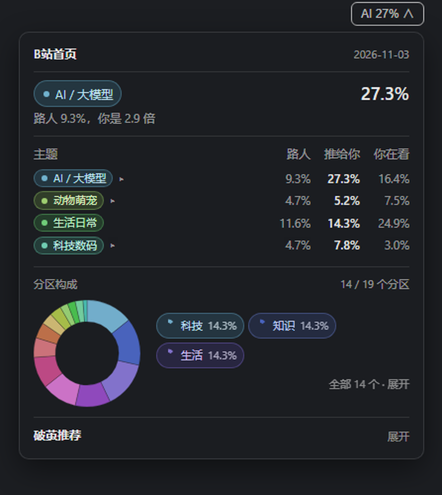

# v0.1.0 — bili-cocoon

Measure what a Bilibili home feed puts in front of one account — and keep that exposure sample separate from a logged-out baseline and from the account's own watch history.

The 0–100 index is partition/uploader concentration (Fu et al. 2024), not a bubble verdict; the theme table, amplification and breakout blocks answer the topic question separately.

Ships with a DeepSeek Harness panel plugin under `plugin/`, plus an offline `--demo` mode that renders the repo fixtures without a cookie or a network call.

## Try it in 3 commands

```bash
git clone https://github.com/Iseapisu/dsh-bilibili-cocoon.git && cd dsh-bilibili-cocoon
node src/cli.js report --demo --out demo-report.md
node src/cli.js score --demo
```

Read every number with its sample: the 27.3 % / 9.3 % / 2.9× example is one account on 2026-11-03, not a general claim.


